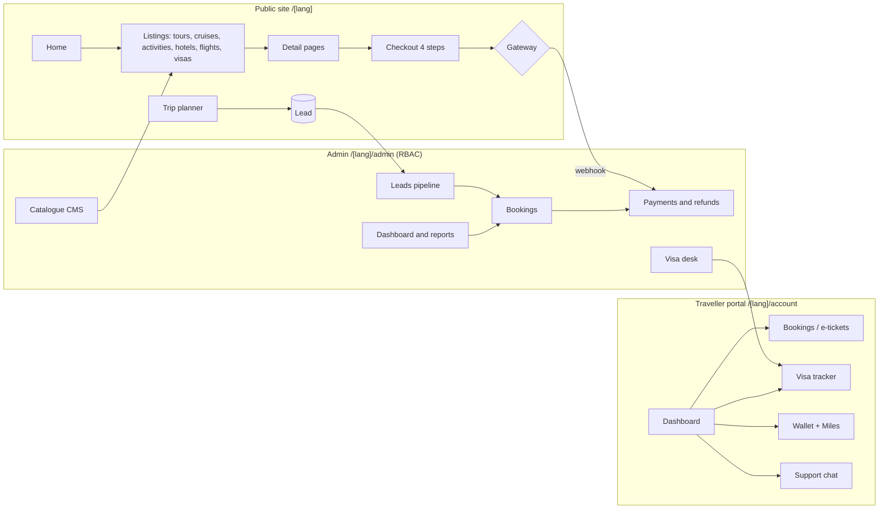

# Musafir: system architecture (target for phase 2)

**Current state (phase 1, this delivery):**
- A static, clickable mock built by a Python + Jinja2 generator. It is bilingual and has no backend; all data is dummy data in `src/data_*.py`.
- Every page, component and data shape is designed to map 1:1 onto the target stack below.

## 1. Target stack

| Layer | Choice | Why |
|---|---|---|
| Web app | **Next.js (App Router)** + TypeScript, React Server Components | SSR/SSG/ISR for SEO; one codebase for the public site, the traveller portal and admin |
| Styling | Tailwind CSS with the same tokens as `tooling/tailwind.config.js` | Lets us carry the mock's styles over largely unchanged |
| i18n | `/en/...` and `/bn/...` route segments (`app/[lang]/...`), with dictionaries in JSON and content fields stored bilingually in the DB | Same URL scheme as the mock; hreflang alternates |
| API | Next.js Route Handlers + server actions, with a typed service layer. A separate REST `/api/v1` serves the mobile app and B2B agents | Thin controllers; logic sits in services |
| Database | **PostgreSQL 16** via Prisma (or Drizzle) | Relational bookings and payments; JSONB for itinerary and SEO blobs |
| Cache / queues | **Redis**: sessions, rate limiting, search cache, BullMQ jobs (emails, SMS, PDF vouchers, supplier sync) | |
| Search | Postgres full-text search + trigram (start); Meilisearch/Typesense once the catalogue exceeds about 5k items | Bangla needs a custom tokenizer, so test both |
| Files | S3-compatible object storage (e.g. Cloudflare R2) + an image CDN (Next/Image or Cloudflare Images) | WebP/AVIF, responsive sizes |
| Auth | Auth.js: email/phone OTP (SMS), Google, password. Staff get mandatory 2FA. RBAC from the `roles` and `permissions` tables | Matches the admin staff and permission matrix |
| Payments | **SSLCommerz** (cards, EMI, net banking), **bKash** and **Nagad** direct APIs, bank transfer with manual reconciliation. Optional Stripe for USD cards | Webhooks → `payments`, idempotent |
| Suppliers | Flights: GDS/NDC (Sabre or Amadeus via an aggregator). Hotels: a bed-bank (Hotelbeds/TBO). Cruises and activities: contracted inventory managed in admin | Open question: choose suppliers |
| Messaging | Email (SES/Postmark), SMS (local gateway such as SSL Wireless), WhatsApp Business API | Templates come from admin → Notifications |
| Observability | Sentry, OpenTelemetry → Grafana, uptime checks, and the audit log in the DB | |
| Hosting | Vercel or a container platform (Fly/Render/AWS ECS) in the Singapore region + Cloudflare in front; managed Postgres with point-in-time recovery | Low latency to BD |

## 2. Application map

## 3. Rendering strategy

| Route | Mode |
|---|---|
| Home, listings, destinations, themes, blog | **ISR**, revalidated on admin publish (tag-based `revalidateTag`) |
| Tour, cruise, activity and hotel details | ISR + client-side price/availability island (fetched live) |
| Flight and hotel search results | SSR (no caching), supplier calls fanned out with a 3–5 s budget and cached in Redis for 10 min |
| Checkout, account, admin | Dynamic, `noindex`, auth-guarded via middleware |

## 4. Booking lifecycle
`draft → pending_payment → confirmed (part_paid | paid) → ticketed/vouchered → travelling → completed`, with branches to `cancelled` or `refunded`.

**Payments:**
- A deposit (30%) is allowed when departure is more than 30 days away; instalment schedules sit in `instalments`.
- Gateway webhooks are verified and stored idempotently. The status change is written to `audit_logs`.

**Cancellation:**
- The policy type is held on the product, so the refund estimate is computed server-side (the same logic the portal's cancel dialog shows).

## 5. Security and compliance
- OWASP ASVS L2.
- CSRF protection on server actions; strict CSP; rate limits on OTP, login and search.
- PII (passport numbers) is encrypted at column level (pgcrypto/KMS). Document uploads use signed URLs and a malware scan.
- PCI scope is minimised: card data is never stored, because hosted gateway pages are used.
- Staff actions are recorded in `audit_logs`; 2FA is mandatory for admin.
- Data protection follows the Bangladesh Personal Data Protection framework plus GDPR-style consent (the cookie banner already exists in the mock).

## 6. SEO architecture (already implemented in the mock)
- Canonical URL and `hreflang` en/bn/x-default on every public page; `sitemap.xml` with alternates; `robots.txt`.
- JSON-LD: TravelAgency/Organization, WebSite + SearchAction, BreadcrumbList, Product/TouristTrip with Offer + AggregateRating, FAQPage, BlogPosting, JobPosting and ItemList.
- Open Graph + Twitter cards; a unique title and description per page and language.
- Semantic HTML; fonts load with `font-display: swap`; images are lazy-loaded with width and height set.

## 7. Scalability
- The web tier is stateless, so it scales horizontally; Postgres has a read replica for reports.
- Slow work goes through queues: PDF vouchers, emails and supplier sync.
- Search moves to a dedicated engine once traffic needs it.
- Partition `audit_logs` and `notifications` by month.
- Multi-currency display is already modelled; settlement stays in BDT.

## 8. Mock → Next.js mapping

| Mock | Next.js |
|---|---|
| `src/templates/base.html`, `partials/*` | `app/[lang]/layout.tsx`, `components/*` |
| `src/templates/ui.html` macros | React components (Card, Badge, Rating, PriceTag…) |
| `src/templates/app/shell.html` | `app/[lang]/(account)/layout.tsx` and `app/[lang]/admin/layout.tsx` |
| `src/data_public.py`, `data_app.py` | Prisma seed scripts (same field names) |
| `src/js/app.js` behaviours | Small client components (`"use client"`) |
